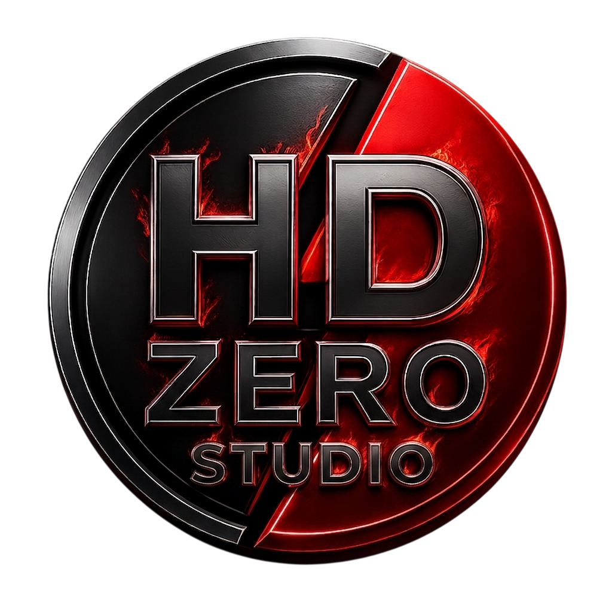
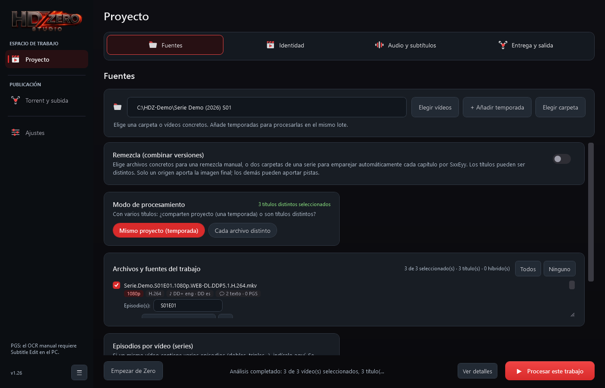
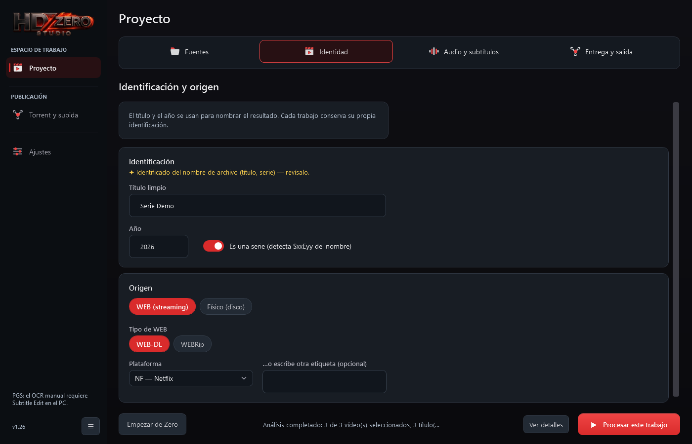
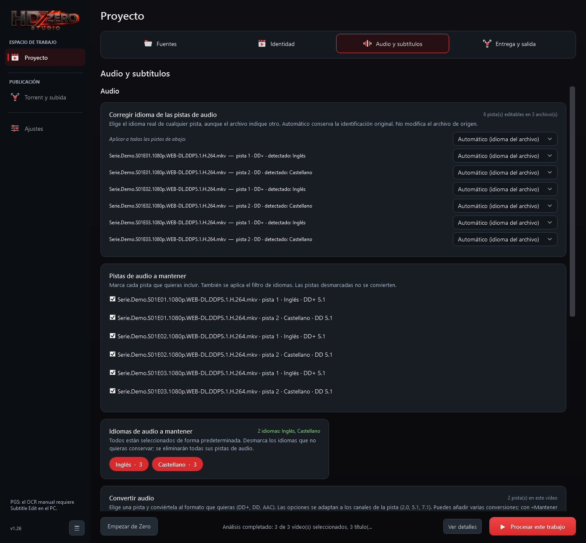
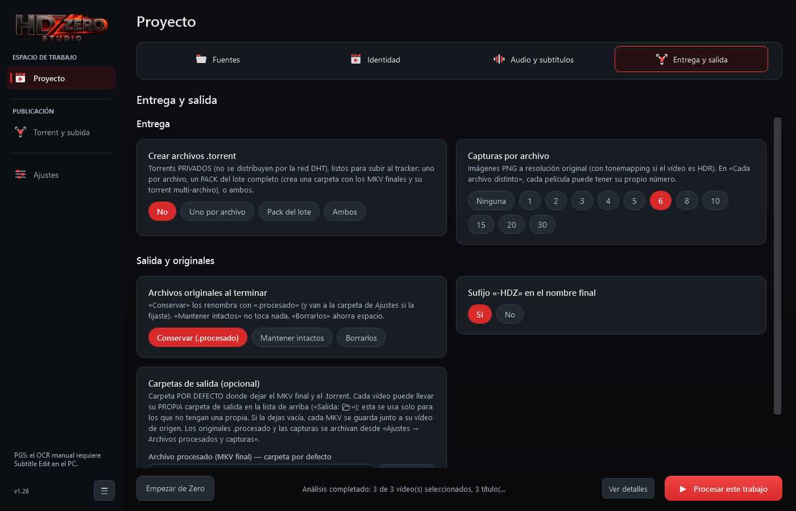
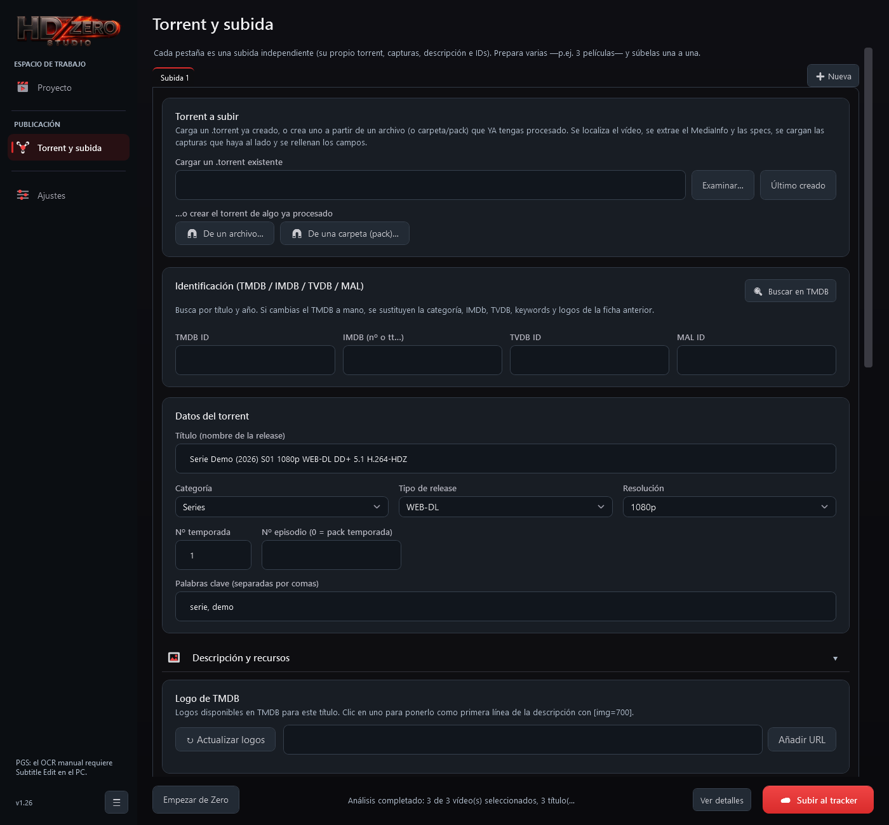
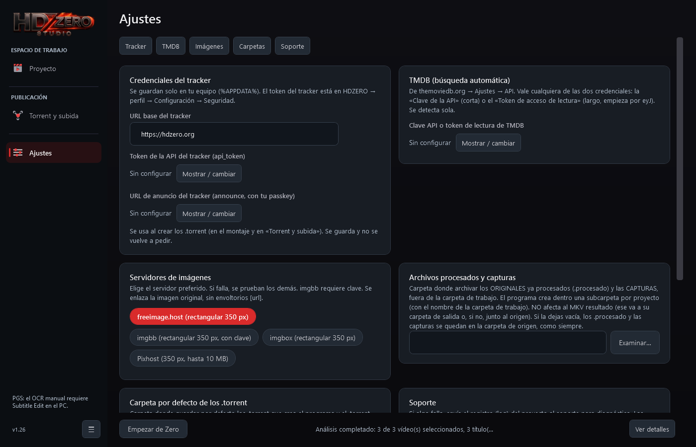

<p align="center">
  
</p>

<h1 align="center">HDZ Studio</h1>

<p align="center">
  Prepara una release de vídeo de principio a fin desde una sola ventana:<br>
  eliges la carpeta, revisas lo que el programa ha detectado y pulsas un botón.
</p>

<p align="center">
  <a href="../../releases/latest"></a>
  
  
</p>

<p align="center">
  
</p>

---

## ¿Qué hace?

Montar un MKV limpio, quitar idiomas que sobran, convertir un audio, sacar capturas, crear
el `.torrent` y rellenar la ficha del tracker suelen ser seis programas distintos y un buen
rato de copiar y pegar. HDZ Studio lo junta todo:

- **Analiza la carpeta por ti.** Detecta pistas de audio y subtítulos, idiomas, resolución,
  HDR y Dolby Vision, y solo te enseña las opciones que tienen sentido para esos vídeos.
- **Monta el MKV final.** Ordena y etiqueta las pistas, elimina lo que no quieres, convierte
  audio si se lo pides y nombra el archivo según su título, año y origen.
- **Fusiona Dolby Vision con HDR10** cuando le das dos versiones del mismo título, y también
  puede combinar pistas de distintas fuentes (remezcla).
- **Hace las capturas** a resolución original, con tonemapping si el vídeo es HDR.
- **Crea torrents privados**, uno por archivo, uno por temporada o ambos.
- **Prepara la ficha y la sube**: busca en TMDB, rellena los IDs, sube las capturas a un
  servidor de imágenes y compone la descripción en BBCode.

Todo se decide en la ventana. Cuando pulsas *Procesar*, el trabajo corre solo en segundo
plano y no te va a hacer preguntas en ninguna consola.

## Un recorrido rápido

### 1. Fuentes

Elige una carpeta, unos vídeos concretos o varias temporadas a la vez. En cuanto lo haces,
el programa analiza cada archivo y muestra lo que lleva dentro: resolución, códec, audios y
subtítulos. Si son episodios de una serie, reconoce el `SxxEyy` del nombre; si son películas
distintas, puedes tratarlas por separado, cada una en su pestaña.

### 2. Identidad



El título y el año salen del nombre del archivo, así que normalmente solo tienes que
comprobarlos. Aquí indicas también el origen (WEB-DL, WEBRip, disco físico) y la plataforma.

### 3. Audio y subtítulos



Ves todas las pistas de todos los archivos en un mismo sitio. Puedes:

- corregir el idioma de una pista que viene mal etiquetada,
- quedarte solo con los idiomas que te interesan,
- convertir una pista a DD+, DD o AAC (las opciones se adaptan a si es 2.0, 5.1 o 7.1),
- elegir qué audio sale por defecto,
- y, en subtítulos, quedarte con un completo, un forzado y un SDH por idioma. Cuando un
  subtítulo no dice qué tipo es, el programa lo deduce y te deja corregirlo.

### 4. Entrega y salida



Decides cuántas capturas quieres, si crear torrents, qué hacer con los originales
(conservarlos con `.procesado`, dejarlos intactos o borrarlos) y dónde guardar el resultado.

Pulsa **Procesar este trabajo** y listo: obtienes el MKV final, sus capturas y el `.torrent`.

### 5. Torrent y subida



Carga el torrent recién creado (o cualquier otro) y el programa localiza el vídeo, extrae el
MediaInfo y recoge las capturas que haya al lado. Busca el título en TMDB para rellenar los
IDs y el logo, elige qué capturas subir, añade tu firma y revisa la vista previa de la
descripción. Con **+ Nueva** puedes preparar varias subidas en pestañas y publicarlas una a una.

### Ajustes



Se configura una vez: el token y la URL de anuncio de tu cuenta del tracker, la clave de TMDB
(opcional) y el servidor de imágenes preferido. Si uno falla, se prueba con los demás.

> **Tus claves son tuyas.** Se guardan solo en tu equipo, dentro de `%APPDATA%`. El programa
> no trae credenciales de nadie y no las envía a ningún sitio salvo al servicio al que
> pertenecen.

## Más cosas que conviene saber

**Capturas desde el Explorador.** Si lo activas al instalar, aparece la opción de hacer
capturas al pulsar con el botón derecho sobre un vídeo, sin abrir el programa. Desde ahí
mismo puedes subirlas y copiar el BBCode.

**Control desde el móvil.** En **Ajustes › Control remoto** puedes dejar que otro
dispositivo de tu red controle HDZ Studio:

1. Activa la opción. Verás una dirección (`http://192.168.x.x:8787`) y un código.
2. Abre la dirección en el móvil e introduce el código una sola vez.

Funciona sin servidores externos. En la red local el tráfico no va cifrado; para usarlo
fuera de casa, conecta el PC y el móvil con [Tailscale](https://tailscale.com) u otra VPN
propia.

**Historial.** Cada trabajo terminado queda registrado con sus rutas, así que puedes volver
a encontrar un MKV o un torrent de hace semanas sin buscar a mano.

## Instalación

1. Descarga `HDZStudio-Setup-<versión>.exe` desde la [última versión](../../releases/latest).
2. Ejecútalo. Se instala en tu carpeta de usuario y no necesita permisos de administrador.
   Si te falta PowerShell 7, el instalador lo instala por ti desde el MSI que trae dentro.

No hace falta instalar nada más: ffmpeg, MKVToolNix, MediaInfo y dovi_tool van incluidos y se
comprueban con SHA256. Se publican aparte, en la versión
[`herramientas`](../../releases/tag/herramientas).

La primera vez que abras el programa te pedirá tus credenciales. Puedes saltártelo y
rellenarlas más tarde en Ajustes.

## Actualizaciones

Cuando sale una versión nueva aparece un botón junto al número de versión. Al pulsarlo, el
programa descarga el paquete de GitHub, comprueba la **firma RSA** del manifiesto y el SHA256
de cada archivo, guarda una copia de seguridad y, si algo sale mal, vuelve a la versión
anterior. Tus ajustes y tu historial se conservan.

## ¿Algo no funciona?

En **Ajustes › Reportar un problema** se guarda una copia del último registro con las claves
censuradas y se abre una [incidencia](../../issues/new) nueva. Échale un vistazo al registro
antes de adjuntarlo, porque las incidencias son públicas.

## Para desarrolladores

HDZ Studio está escrito en PowerShell 7 con una interfaz WPF.

| Archivo | Qué es |
| --- | --- |
| `HDZ-GUI.ps1` | La interfaz. Recoge las decisiones y lanza el motor. |
| `HDZnew.ps1` | El motor de montaje. Corre como proceso aparte y recibe la configuración en `HDZ_CONFIG`. |
| `HDZ-Remote.ps1` | Servidor local de la web de control remoto (`web/index.html`). |
| `HDZ-Capturas*.ps1` | Capturas, su subida y el menú contextual del Explorador. |
| `instalacion/` | Instalador, actualizador y `Preparar-Release.ps1`. |

Para pasar las pruebas:

```powershell
pwsh -NoProfile -File soporte/tests/Run-All.ps1
```

Las pruebas web necesitan Node y Playwright (`HDZ_PLAYWRIGHT` apunta a su carpeta si no está
instalado de forma global).

Las capturas de este README se generan con la propia interfaz en modo prueba
(`HDZ_GUI_TEST=1`), con vídeos sintéticos y sin ninguna cuenta configurada.

## Historial de versiones

Las notas de cada versión están en [Releases](../../releases). Las versiones v1.0 a v1.22
corresponden a las publicaciones internas 1.17.16 a 1.17.38.
